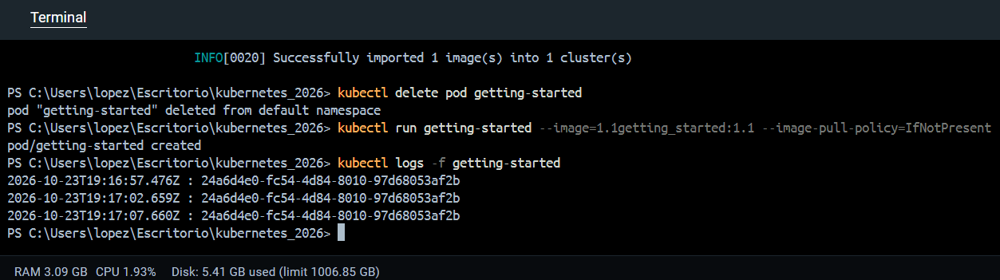
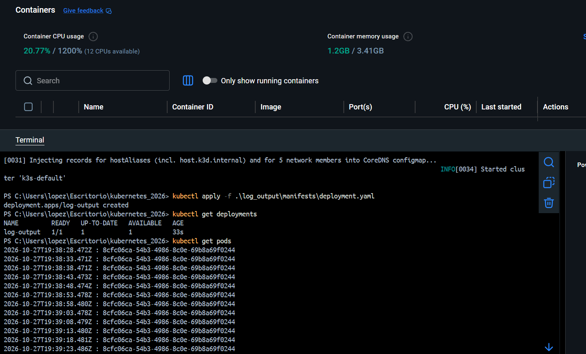

# 1.3. Declarative approach

Solution for exercise 1.3. Declarative approach of the University of Helsinki's DevOps with Kubernetes course.
(In previous versions, this was the solution for exercise 1.1.).

## Description

This application generates a random string when it starts, stores it and prints the same string alongside a UTC timestamp every five (5) seconds.

To generate a random string I used the Guid.NewGuid() method from the Guid class.

<i>The UUID remains constant during the same application execution. A new UUID is generated when the application restarts.</i>

## Run locally

From this directory, run:

```bash
dotnet run
```

The application output should looks like:

```text
2026-10-23T19:13:19.058Z : bb1fe8e1-73ce-4730-998c-cf73728b3447
2026-10-23T19:13:24.058Z : bb1fe8e1-73ce-4730-998c-cf73728b3447
```

The timestamps and string will differ between executions.

## Build the Docker image

From this directory, run:

```bash
docker build -t 1.1getting_started:1.1 .
```

## Run in Kubernetes

The image must be available to the Kubernetes cluster. When using k3d, import the local image:

```bash
k3d image import 1.1getting_started:1.1 -c k3s-default
```

Create a Pod:

```bash
kubectl run getting-started --image=1.1getting_started:1.1 --image-pull-policy=IfNotPresent
```

View the application logs:

```bash
kubectl logs -f getting-started
```

Delete the Pod when finished:

```bash
kubectl delete pod getting-started
```

## Declarative approach

Deploy:

```bash
kubectl apply -f .\log_output\manifests\deployment.yaml
```
Verify the deployment:

```bash
kubectl get deployments
kubectl get pods
```

Follow the application logs:

```bash
kubectl logs -f deployment/log-output
```

Verify Pod recovery
This is very important, because the deployment should automatically create a replacement Pod.

```bash
kubectl delete pod -l app=log-output
```

Update the deployment after modifying the manifest:

```bash
kubectl apply -f .\log_output\manifests\deployment.yaml
```

This exercise introduces the declarative approach to managing Kubernetes resources using YAML manifests.

## Screenshots



The first time my code was wrong (it was generating a random string every iteration) so I needed to fix that, start again with the pod and import another image that was build with the right code.


This exercise introduces the declarative approach to managing Kubernetes resources using YAML manifests.