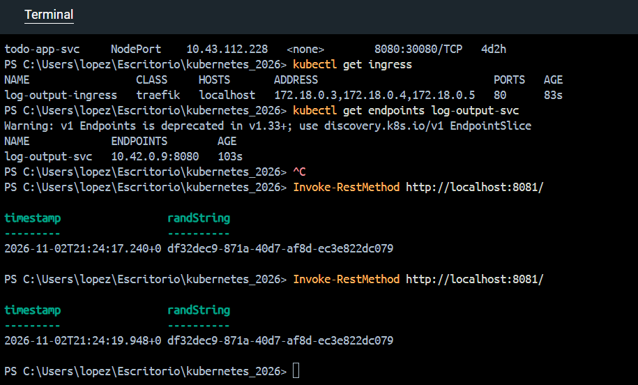
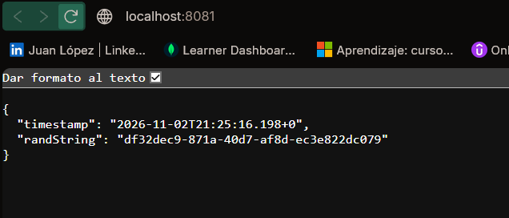

# 1.7. External access with Ingress

Solution for exercise 1.7. External access with Ingress of the University of Helsinki's DevOps with Kubernetes course.

## Description

The Log output application generates a random string when it starts and prints it alongside the current timestamp to the application logs every five seconds.

This application has a HTTP endpoint to request the current status, it prints the timespampt and the random string.

<i>The string remains constant during the same application execution. A new string is generated when the application restarts.</i>

## Endpoint Structure

Method: GET
Path: /

The endpoint returns a JSON response:
```bash
{
    "timestamp": "2026-11-02T21:24:17.240Z",
    "randString": "df32dec9-871a-40d7-af8d-ec3e822dc079"
}
```

## Run locally

From this directory, run:

```bash
dotnet run
```

The application output should looks like:

```text
2026-10-23T19:13:19.058Z : bb1fe8e1-73ce-4730-998c-cf73728b3447
2026-10-23T19:13:24.058Z : bb1fe8e1-73ce-4730-998c-cf73728b3447
```

The timestamps and string will differ between executions.

## Build the Docker image

From this directory, run:

```bash
docker build -t log_output:1.7 .
```

## Run in Kubernetes

The image must be available to the Kubernetes cluster. When using k3d, import the local image:

```bash
k3d image import log_output:1.7 -c k3s-default
```

Deploy:

```bash
kubectl apply -f .\log_output\manifests\deployment.yaml
```

Verify the deployment:

```bash
kubectl get deployments
kubectl get pods
```

Follow the application logs:

```bash
kubectl logs -f deployment/log-output
```

Service:

```bash
kubectl apply -f .\log_output\manifests\service.yaml
```

Ingress:

```bash
kubectl apply -f .\log_output\manifests\ingress.yaml
```

Access the application:
```bash
http://localhost:8081/
```

This exercise works like an introduction for the Ingress concept, an Ingress is an object from the API that is used to
manage the HTTP and HTTPS trafficc to our services inside a cluster.

## Screenshots




