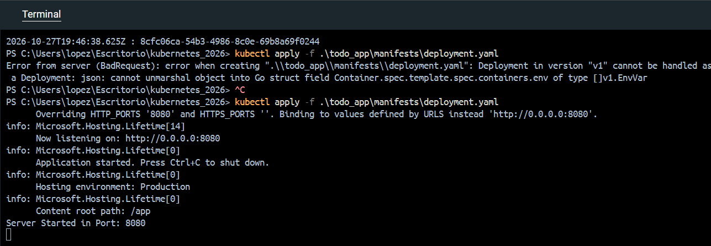

# 1.4. The project, step 2

Solution for Exercise 1.4. The project, step 2

## Description

An application that creates an ASP.NET Core web server. The application reads the `PORT` environment variable to configure the listening port. If the variable is not set to a valid port, it uses `8080` by default. This application has this structure to fulfill the expected output that prints the following message to the console:
`Server started in port NNNN`

## Run in Kubernetes

Applying manifest:
```powershell
kubectl apply -f .\todo_app\manifests\deployment.yaml
```

Check its status and logs:

```powershell
kubectl get deployments
kubectl get pods
kubectl logs -f deployment/todo-app
```

## Screenshots



At first, I had this error on deployment, because I wasn't respecting the identation.
But at the end, the app runs.