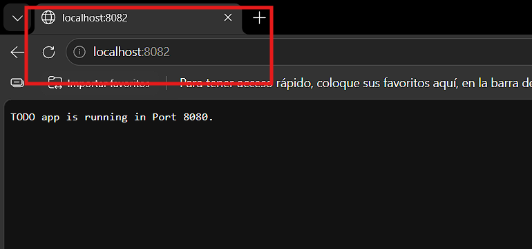
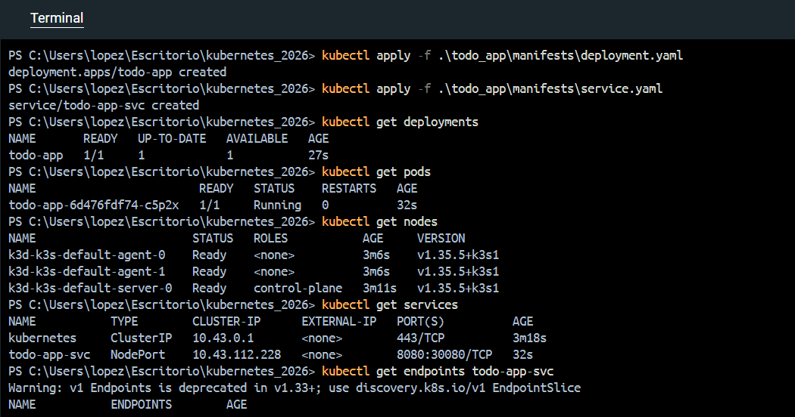
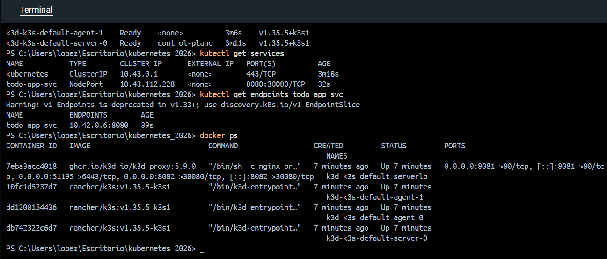

# 1.6. The project, step 4

Solution for Exercise 1.6. The project, step 4

## Description

The app has a setup with a NodePort.

The Todo App responds to HTTP GET requests sent to the / endpoint with a message indicating 
that the application is running. The application responds `TODO app is running in Port NNNN.`.

## Run in Kubernetes

Cluster creation:
```powershell
k3d cluster create --port 8082:30080@agent:0 -p 8081:80@loadbalancer --agents 2
```

Apply the Deployment:
```powershell
kubectl apply -f .\todo_app\manifests\deployment.yaml
```

Apply the Service:
```powershell
kubectl apply -f .\todo_app\manifests\service.yaml
```

## Screenshots





