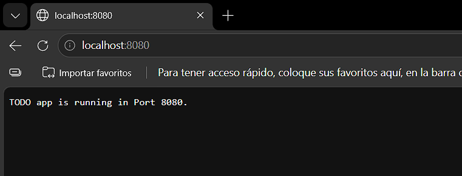

# 1.5. The project, step 3

Solution for Exercise 1.5. The project, step 3

## Description

The Todo App responds to HTTP GET requests sent to the / endpoint with a message indicating 
that the application is running. The application responds `TODO app is running in Port NNNN.`.

## Run in Kubernetes

Apply the Deployment:
```powershell
kubectl apply -f .\todo_app\manifests\deployment.yaml
```

Check its status and logs:

```powershell
kubectl get deployments
kubectl get pods
kubectl logs -f deployment/todo-app
```

Access the app:
```powershell
kubectl port-forward pod/{pod} 8080:8080
```
It's necessary to replace {pod} with the name of the running Pod.
Open localhost:8080/ in a web browser (in my case I did it in Edge) to verify
the application responds to a GET request.

## Screenshots



Here we can see the app responds to a GET request.