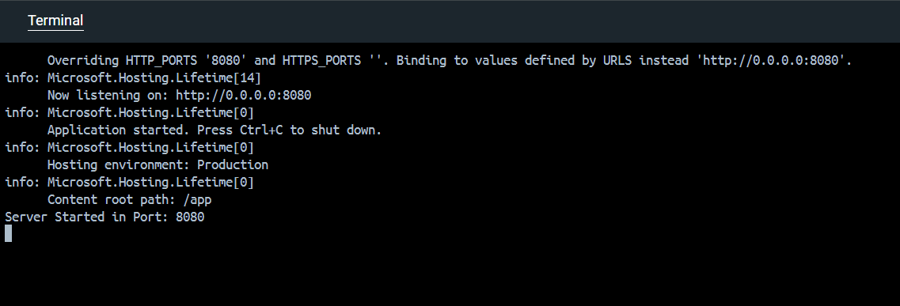
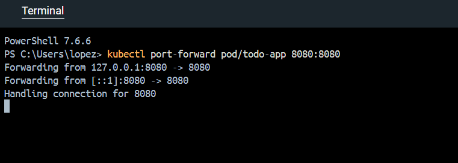
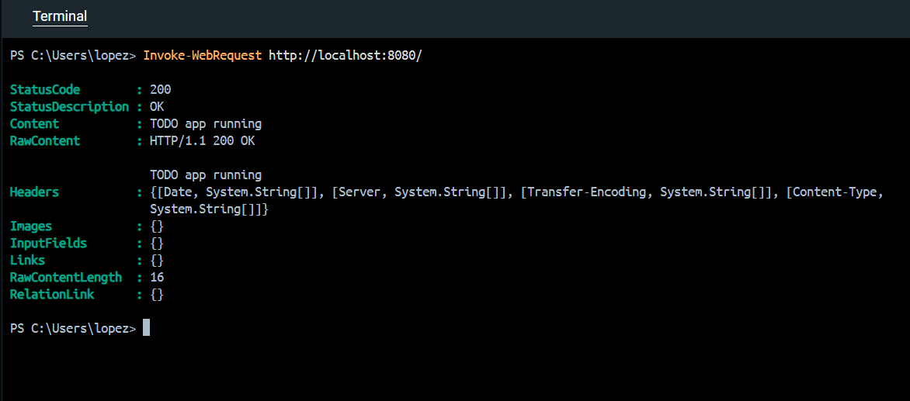

# 1.2. The project, step 1

Solution for Exercise 1.2. The project, step 1

## Description

An application that creates an ASP.NET Core web server. The application reads the `PORT` environment variable to configure the listening port. If the variable is not set to a valid port, it uses `8080` by default. This application has this structure to fulfill the expected output that prints the following message to the console:
`Server started in port NNNN`

The root endpoint (`/`) returns a simple response confirming that the server is running.

## Run locally

From this directory, execute:

```powershell
dotnet run
```

The server may listen on port `8080`.

To configure a different port we need to use the PowerShell (replace 'NNNN' with the port you want to use):

```powershell
$env:PORT="NNNN"
dotnet run
```

Test the endpoint (replace 'NNNN' with the port):

```powershell
Invoke-WebRequest http://localhost:NNNN/
```

## Build the Docker image

From the repository root:

```powershell
docker build -t todo_app:1.2 -f .\todo_app\Dockerfile .\todo_app
```

## Run in Kubernetes

Import the local image into the k3d cluster:

```powershell
k3d image import todo_app:1.2 -c k3s-default
```

Create the Pod:

```powershell
kubectl run todo-app --image=todo_app:1.2 --image-pull-policy=IfNotPresent
```

Check its status and logs:

```powershell
kubectl get pods
kubectl logs todo-app
```

## Test the HTTP endpoint in Kubernetes

Forward the Pod's port to the local machine (for the following 'NNNN', same instructions than in above sections):

```powershell
kubectl port-forward pod/todo-app NNNN:NNNN
```

In another terminal, run:

```powershell
Invoke-WebRequest http://localhost:NNNN/
```

The expected response is `TODO app running`.

The port-forward command must remain running while testing.

## Screenshots



This screenshots shows the terminal showing that the app is running without errors.



Here you can see the commands to forward 8080 port. This is a necessary step to test the endpoint.



Finally, the request that validates everything is working right.